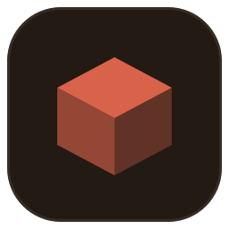
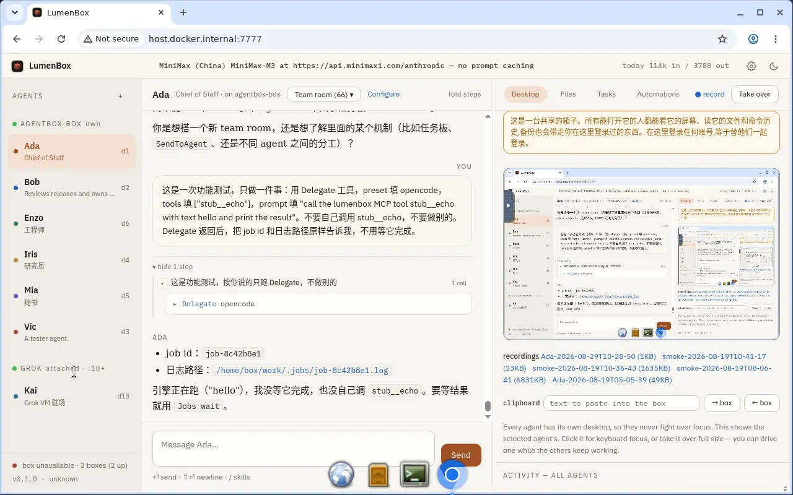

  

<h1 align="center">LumenBox</h1>

  Your own team of AI agents, each with a real computer to work on — reached from your desktop and your chat apps, taken over at any moment, and believed on the record, not on its word.

  <a href="https://github.com/fakechris/lumenbox/releases/latest">Download for macOS</a> ·
  <a href="docs/37-onboarding.md">Getting started</a> ·
  <a href="docs/manual/README.md">Manual</a> ·
  <a href="docs/38-operators-guide.md">Operator's guide</a> ·
  <a href="docs/03-architecture.md">Architecture</a> ·
  <a href="docs/89-thesis.md">Design</a> (<a href="docs/89-thesis.zh.md">中文</a>)

---

LumenBox gives you a small team of agents — each with a name, a memory, its own desktop and a
shell — on a Linux "box" you can watch and take over at any moment. You talk to them in the app
or from Feishu and DingTalk; they read documents, browse, write code, run it, and keep a task
board of what they owe you. How that differs from a coding-agent CLI or a hosted agent platform
is one table in [the product spec](docs/02-product.md#11-how-it-differs).

  

## What it believes · 设计理念

LumenBox is built around four questions: on which machine an agent works, who should do a piece
of work, whether it may, and why anyone should believe it when it says "done". Each has one place
where it is answered.

LumenBox 围绕四个问题设计：agent 在哪台机器上做事，一件事该谁做，它能不能做，它说"做完了"时凭什么信。每个问题只在一处回答。

- **Write the record before the capability.** What an agent actually did is kept as data, not as
  its summary of itself; a capability without a record gets claimed, never proven.
  **先写记录，再写能力。** agent 真正做了什么存成数据，不是它对自己的总结；没有记录的能力只会被宣称，不会被证明。
- **Unknown is never success.** Desktop actions carry evidence of their effect, and an action
  whose outcome is unknown is not counted as done and not retried on its own.
  **未知永远不算成功。** 桌面动作带效果证据；结果不明的动作不算完成，也不会被自动重试。
- **Two gates, and no third.** The installation decides who you are; the box decides what can be
  reached. Channels and agents carry no authority, and agents in one box are equal in reach.
  **两道门，没有第三层。** 安装决定你是谁，box 决定能到哪。渠道和 agent 不带权限，同一台 box 里的 agent 能到的地方一律平等。
- **A person is never locked out.** You can watch any desktop and take it over; while you hold
  it the agent waits, and what you do there can become a skill.
  **人不会被锁在外面。** 任何桌面都能看、能接管；你接管时 agent 必须等，你做的一遍可以学成技能。
- **Boundaries in code, wording for the team.** Gates, budgets and refusals live in code; tone and
  "what counts as done" live in text your team can change.
  **边界用代码画，措辞让团队改。** 门、预算、拒绝在代码里；语气和"怎么算做完"在团队能改的文本里。
- **When it can stop and ask, it does not guess.** Paying, sending, deleting and publishing ask a
  person first. An extra question costs a sentence; a wrong send cannot be taken back.
  **能停下来问人，就不要猜。** 付款、发送、删除、发布先问人。多问一句只是一句话，发错了收不回来。

The whole argument, with the layers, the decisions and the paths refused:
[The design of LumenBox](docs/89-thesis.md) · [LumenBox 的设计](docs/89-thesis.zh.md).

## What it does

- **A team, not a chatbot.** Several agents with different jobs, who message each other and
  decide who does what. One coordinates and answers you first; the others work.
- **A real computer.** Every agent gets its own Linux desktop with a browser and a shell — a
  container on your Mac, or a machine of yours anywhere. You can watch each desktop live and
  drive it with your own mouse while the agent keeps working elsewhere.
- **In your chat apps.** Connect Feishu (飞书) or DingTalk (钉钉): a message in the group chat
  is a message to the agent, replies land in the thread, files go both ways, long jobs show a card
  that updates as they run, and approvals are buttons.
- **Memory that is yours.** What an agent learns about you and your work is kept in plain files
  you can read and edit, per agent and per team, and never leaves your machine.
- **Skills you can install and share.** A skill is a folder with a `SKILL.md` — the format four
  other projects use — so what you write for one agent works for another, and a whole agent can
  be packed and handed to someone as a template.
- **Honest about what it did.** Every tool call, every screenshot, every approval is on the
  record, and the agent is held to it: a claim it did not check is sent back to check.

## Getting started

1. **Install.** Download the `.dmg` from the
   [latest release](https://github.com/fakechris/lumenbox/releases/latest) and drag LumenBox
   to Applications. From 0.3.0 the app is signed with a local development certificate and is
   not notarized, so the first time either right-click →
   *Open*, or run `xattr -dr com.apple.quarantine /Applications/LumenBox.app`.
2. **Give it a key.** Settings opens by itself: pick a model provider and paste a key
   (Anthropic, MiniMax, DeepSeek, Zhipu, Moonshot, OpenAI, or any OpenAI-compatible endpoint).
3. **Give it a computer.** Install [Docker Desktop](https://www.docker.com/products/docker-desktop/)
   or [OrbStack](https://orbstack.dev/), then press *Start the box* in Settings. The first time,
   that pulls `fakechris/lumenbox` at this app's version from Docker Hub. From a checkout,
   `npm run build:image` builds it locally instead. No Docker? A box can live on another
   machine of yours, or be a Grok Bot's box — see
   [Getting started](docs/37-onboarding.md) for every path.
4. **Say hello.** Ada answers. Ask for something real.

The whole walkthrough, including chat-app setup and what to do when something is wrong:
[docs/37-onboarding.md](docs/37-onboarding.md).

## Bring your own box

The box does not have to be on your Mac.

- **Docker elsewhere.** Point the app at a remote engine the way you point `docker` at one
  (`DOCKER_HOST` or a docker context).
- **A Grok Bot's box.** Add the [LumenBox Bridge](https://x.ai/bot/U8xEPyVxQHL_JznVhVotB)
  template to Grok Bot; the Grok Bot it creates prepares its own box over your Tailscale network and
  tells you what to paste. Nothing of the Grok bot's is touched.
- **Any Linux machine.** One script, `lumen-bridge.sh`, from the releases page.

Agents are created into a box and stay there; each box keeps its own desktops, skills and memory.
Desktops start on demand. A newly created, unused desktop can release its processes after
15 idle minutes; viewing, pinning or using it prevents automatic cleanup. Existing sessions
and uncertain workloads are kept. Settings shows the resource state and why a desktop is
retained. **Keep desktop** pins it for the current daemon session. Files and browser profiles
are never deleted by reclamation. Operators can set `BOXD_DESKTOP_IDLE_MS` in the box environment;
`0` disables automatic reclamation. A failed stop is shown as an unknown process state and
requires inspection before that desktop can be reused.

## How it is different

Most agent products give you one assistant and a sandbox you cannot see. LumenBox gives you
several, each with a screen you can look at, on a computer you own — and it writes down what
they did in a form you can read, dispute and keep. It is built to be run by one person for
themselves or a small team, and to stay honest under weak models: the engine, not the prompt,
makes sure a promise is followed by an action.

## Documentation

- [Getting started](docs/37-onboarding.md) — install, first run, every way to get a box.
- [Manual](docs/manual/README.md) — how to use each thing, one page per concept.
- [Operator's guide](docs/38-operators-guide.md) — every command, every setting, providers, testing.
- [The design of LumenBox](docs/89-thesis.md) ([中文](docs/89-thesis.zh.md)) — the layers, principles and decisions in one argument.
- [Architecture](docs/03-architecture.md) and [the design docs](docs/) — how it works and why.
- [Security](docs/10-security-backlog.md) — what is and is not a boundary, stated plainly.

## Status

Early, used daily by its author, English and Chinese. macOS builds only so far. Issues and pull
requests are welcome; the design docs say what each part is for, and a change that contradicts
one should say so.

## License

GPL-3.0. The CLI and internal names still say `agentbox`, the working name.

Bundled into the page and the box image, under their own licences: markdown-it (MIT), and for
ShowUI cards (docs/79) @a2ui/web_core and @a2ui/lit (Apache-2.0) with lit (BSD-3-Clause).
