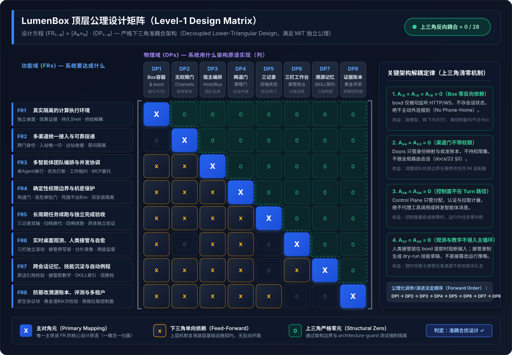
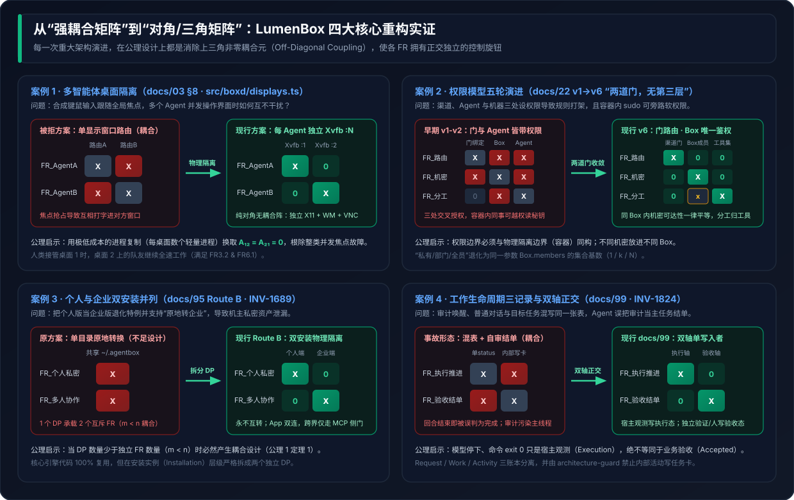
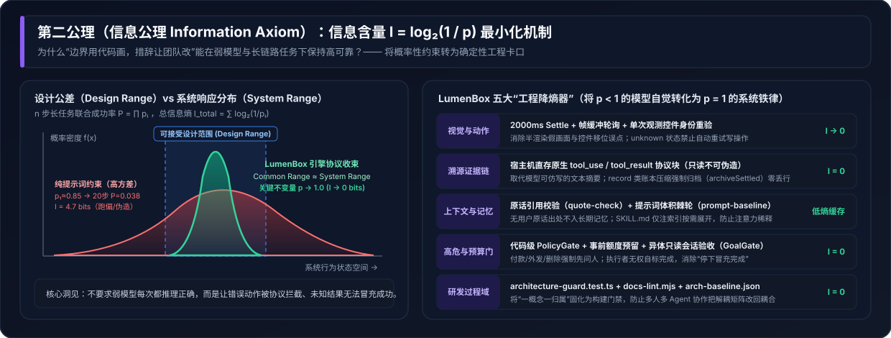

<!-- doc: 104-axiomatic-design
     title: LumenBox 功能需求提取与 MIT 公理设计分析
     family: decision
     status: current
     updated: 2026-11-26
-->
# 104. LumenBox 功能需求提取与 MIT 公理设计分析

本文运用麻省理工学院（MIT）Nam P. Suh 教授提出的**公理设计理论（Axiomatic Design, AD）**，对 LumenBox（`agentbox`）进行系统化的功能需求（FRs）提取、设计参数（DPs）映射、设计矩阵耦合度推演及信息含量（Information Content）诊断。

LumenBox 在 [docs/89-thesis.zh.md](89-thesis.zh.md) 中确立的核心命题——**“围绕四个问题设计，每个问题只在一处回答”**、**“两道门，没有第三层”**、**“先写记录，再写能力”**、**“边界用代码画，措辞让团队改”**——在数学结构上恰好对应着公理设计的两大基石：**独立公理（矩阵对角化/下三角化）**与**信息公理（在不确定模型之上令关键不变量信息熵归零）**。

---

## 1. 公理设计四域模型与系统约束（Domains & Constraints）

公理设计将复杂工程设计定义为四个相邻域之间的迭代映射：

$$\text{客户域 } \{CA\} \longrightarrow \text{功能域 } \{FR\} \longrightarrow \text{物理域 } \{DP\} \longrightarrow \text{过程域 } \{PV\}$$

其核心线性/非线性局部关系由**设计方程（Design Equation）**给出：

$$\{FR\} = [A] \cdot \{DP\}, \qquad A_{ij} = \frac{\partial FR_i}{\partial DP_j}$$

在映射之前，必须先剥离横跨全局的非功能红线——即**约束条件（Constraints, $\{C\}$）**。约束不需要独占一个独立 DP，但所有候选 DP 组合都不得越界：

| 约束编号 | 约束名称 | 量化指标与制度边界 | 规范与门禁依据 |
| :--- | :--- | :--- | :--- |
| **C1** | **容器物理信任边界** | 容器（Box）是唯一真实安全隔离边界；容器内 Agent 持有 `sudo`，不放置机主不愿交给模型的秘密 | [01-requirements](01-requirements.md) N3.1 · [03-architecture](03-architecture.md) §5 |
| **C2** | **观测与交互延迟上限** | 空闲截屏 `< 300ms`（1280×800），满载退化 `< 50%`，实时画面延迟 `< 1000ms`（实测 `123ms`） | [01-requirements](01-requirements.md) N1 · [07-review](07-review.md) R-06 |
| **C3** | **诚实失败与三值/四值逻辑** | 静默失败与崩溃同罪；结果不明（`unknown`）绝不计入成功，且禁止自动重试写操作 | [01-requirements](01-requirements.md) N4 · [89-thesis.zh](89-thesis.zh.md) §9 |
| **C4** | **事前预算拦截与事前审计** | 费用上限、回合上限、唤醒频率必须在花费发生**之前**拒绝；允许/拒绝裁决先落盘后执行 | [01-requirements](01-requirements.md) N6 · `src/host/policy.ts` |
| **C5** | **单一归属与代码/提示词棘轮** | 同一概念在全仓仅有一处定义；超 1000 行文件（`arch-baseline.json`）与每轮固定提示词字节数（`prompt-baseline.json`）只降不升 | `src/host/architecture-guard.test.ts` · `scripts/arch-ratchet.mjs` |

---

## 2. 功能需求树（FRs）与设计参数树（DPs）的“之字形分解”

公理设计强调**之字形分解（Zigzagging）**：不能脱离架构空想底层需求，而必须先在顶层完成 $\text{FR}_0 \to \text{DP}_0$ 映射，再回到功能域分解一级 $\text{FR}_1 \dots \text{FR}_8$，逐层交替下钻。

### 2.1 顶层映射（Level 0）

- **$\text{FR}_0$（总功能需求）**：构建一套面向个人或组织的多智能体团队系统，使多名 AI Agent 能在可随时接管的真实计算机上持续协同工作，全渠道可达，且以客观记录与人工验收作为可信交付依据。
- **$\text{DP}_0$（总设计参数）**：**四层正交分离架构**——无权限接入渠道门（Channels） + 宿主机编排器（Host Orchestrator） + 每 Agent 独立桌面的 Linux 容器守护进程（Box / `boxd`） + 出站中继与旁路控制面（Egress Relay / Control Plane），层间仅通过 `HTTP JSON + Bearer + 单路屏幕 WebSocket` 通信。

### 2.2 一级与二级功能需求完整映射表（Level 1 & Level 2：8 大域 · 32 项子需求）

| 编号 | 功能需求 FRs（功能域：系统必须达成什么） | 对应设计参数 DPs（物理域：LumenBox 用什么机制实现） | 核心源码与规范锚点 |
| :--- | :--- | :--- | :--- |
| **FR1** | **提供真实、隔离、可持久演进且可随时重建的计算执行环境** | **DP1：Box 容器架构与无会话状态的 `boxd` 守护进程（状态外置挂载卷）** | `docker/box/Dockerfile`, `src/boxd/` |
| FR1.1 | 为每个 Agent 提供互不抢占输入焦点的真实图形桌面 | DP1.1：每 Agent 独立 `Xvfb :N` + `xfwm4 --compositor=off` + `picom` + 独立 VNC 端口，统一经 `boxd` 反代 | `src/boxd/displays.ts`, `src/cua/x11-executor.ts` |
| FR1.2 | 执行桌面与浏览器操作，严格区分“指令发出”与“界面生效” | DP1.2：桌面执行契约（单次观测控件身份引用 + 邻域像素/DOM 回读 + `progress/effect/verification` 分离四态裁决） | `src/boxd/desktop-operations.ts`, [03-architecture](03-architecture.md) |
| FR1.3 | 提供跨调用保持工作目录与环境变量的 Shell、后台作业及独立文件读写 | DP1.3：`shell-service` 持久会话 + 超时自动转后台的 `job-service` + 独立于 Shell 的 `fs-service` | `src/boxd/shell-service.ts`, `job-service.ts`, `fs-service.ts` |
| FR1.4 | 使计算机供给形态（本地容器/远端机器/K8s）对上层运行时透明可替换 | DP1.4：`BoxProvisioner` 抽象（`docker` / `attached` / `host` / `kubernetes`）+ 机器代际号 `box-generation` 过滤旧回调 | `src/box/`, `src/host/box-generation.ts` |
| **FR2** | **实现多渠道统一接入，将外部异步事件可靠转化为内部请求** | **DP2：“无权限门（Stateless-Authority Doors）”多渠道接入与收发账本层** | `src/channels/`, [22-domain-model](22-domain-model.md) |
| FR2.1 | 跨桌面 App、飞书、钉钉、Telegram、Webhook 与 MCP 识别同一自然人 | DP2.1：`Principal` 主体模型 + 携带渠道代际号（`incarnation`）的多渠道 `Identity` 地址映射 | `src/channels/identity.ts`, [48-identity-consistency](48-identity-consistency.md) |
| FR2.2 | 保证入站消息不漏接、不重放，从用户原话到触发回合全程单 ID 贯通 | DP2.2：门入口唯一铸造消息 UUID（`architecture-guard` 禁止下游重铸）+ 入站账本 `inbox.jsonl` 先落盘后应答 | `src/channels/manager.ts`, `ingress.ts`, [26-inbound-reliability](26-inbound-reliability.md) |
| FR2.3 | 约束出站消息语义与幂等性，杜绝无交付物的空汇报与重试双发 | DP2.3：出站目的门（结果必含交付物、提问必含待答项、回答必对问题）+ 确定性编号与发送收据 `sent-ledger` | `src/host/outbound.ts`, `src/channels/sent-ledger.ts`, [101-speaking-unprompted](101-speaking-unprompted.md) |
| FR2.4 | 按沟通场域隔离上下文，支持同一 Agent 跨多个群聊/私聊房间并发服务 | DP2.4：Per-Room 会话隔离布局（团队主房间 `conversation.jsonl` vs 外部房间 `conversations/<id>.jsonl`） | [01-requirements](01-requirements.md) F11.1, `src/channels/conversations.ts` |
| **FR3** | **编排多智能体职责分工、异步消息传递与并发写协调** | **DP3：宿主机编排器（Host Orchestrator）、团队名册与 Actor 消息总线** | `src/agents/`, `src/host/orchestrator.ts` |
| FR3.1 | 管理多名拥有独立身份、人格、配置版本历史与工具集分工的 Agent | DP3.1：`AgentRegistry`（Box 归属与团队关系的唯一权威）+ 原子替换 `profile.json` + 不可变版本链 `config-versions.jsonl` | `src/agents/registry.ts`, `config-versions.ts` |
| FR3.2 | 保证单个 Agent 在同一会话内严格串行，同时保障人类指令优先插队 | DP3.2：单 Agent 回合锁 + 排空式唤醒循环（Drain Loop）+ 仅允许打断非用户回合的优先级消息槽 | `src/agents/bus.ts`, `src/host/actor-queue.ts`, [04-design](04-design.md) §2 |
| FR3.3 | 阻止多 Agent 或人机并发时的“重复抢单”、“覆盖他人文件”与“提示词注入传染” | DP3.3：跨重启持久工作租约（`claims.ts`）+ 写前已读校验（OCC）+ 派生隔离会话承载内部协同 | `src/host/claims.ts`, [32-coordination-protocol](32-coordination-protocol.md) |
| FR3.4 | 支持将编码或专项子任务安全委托给容器内的外部引擎执行 | DP3.4：宿主按作业动态签发带租约的 MCP 侧门路由（`/mcp/r/<key>`）与 ACP 会话桥接，凭据永不入容器 | `src/host/mcp-face.ts`, `acp-delegate.ts`, [33-mcp-face](33-mcp-face.md) |
| **FR4** | **实施确定性的权限隔离、高危动作人工审批与机密零泄漏** | **DP4：“两道门”领域模型 + 代码级策略门（PolicyGate）+ 出站中继（Egress Relay）** | [22-domain-model](22-domain-model.md), `src/host/policy.ts`, `src/egress/` |
| FR4.1 | 用最简且无歧义的模型界定“谁能用系统”与“谁能碰哪些机器和机密” | DP4.1：外门（Installation 级 `Principal.role`）+ 内门（`Box.members` 集合；同一 Box 内所有 Agent 机密可达域严格一致） | `src/host/principals.ts`, [22-domain-model](22-domain-model.md) §0 |
| FR4.2 | 拦截付款、外发、删除、发布、越权宿主机调用及多步重复提交 | DP4.2：收口于 10 个法定调用点的 `PolicyGate` + 唯一副作用声明表 `side-effects.ts` + 浏览器写路径锁 `write-path.ts` + 工作授权书 `mandate.ts` | `src/host/policy.ts`, `side-effects.ts`, `write-path.ts`, `mandate.ts` |
| FR4.3 | 允许 Agent 调用受保护外部接口或填充登录表单，但阻断密钥明文外泄 | DP4.3：宿主 `Vault` + 无默认路由内网围栏 `box-network.ts` + `Egress Relay` 代填 + `provider.ts` 精确值脱敏钩子 | `src/host/vault.ts`, `src/box/box-network.ts`, `secret-redaction.ts` |
| FR4.4 | 彻底杜绝个人自用状态在多人协作演进时意外泄漏给他人 | DP4.4：双安装并列模型（`single-machine` 机主独占永不加第二人 vs `organisation` 服务端运行，客户端同时挂载双端） | `src/host/installation.ts`, [95-two-installations](95-two-installations.md) |
| **FR5** | **保障超长任务跨上下文窗口与进程中断持续推进，且验收权受控** | **DP5：三记录双轴工作模型 + 上下文换代管家 + 独立验证会话闸门** | [99-user-work](99-user-work.md), `src/host/compaction.ts`, `goal-loop.ts` |
| FR5.1 | 区分一问一答、跨回合工作与内部动作，一眼看清每件事在等谁 | DP5.1：`Request / Work / Activity` 三账本物理分离 + Work 双正交状态轴（`Execution × Acceptance`）+ 互斥全覆盖注意力表 `attention.ts` | `src/host/tasks.ts`, `task-stage.ts`, `attention.ts` |
| FR5.2 | 当对话超出模型窗口时压缩历史，不丢目标计划，且保留原文可查 | DP5.2：稳定前缀双缓存断点 + 保留 `plan.md/todos.json` 的显式压缩器 `compaction.ts` + `conversation.jsonl.epochs` 换代目录 | `src/host/compaction.ts`, `context-recovery.ts`, [23-context-compaction](23-context-compaction.md) |
| FR5.3 | 在无人盯守下按预算自动续跑持久目标，识别空转与重复死胡同 | DP5.3：`GoalLoop` 四道停机闸（空转/无变化/轮数/成本）+ 假设实验账本（连续重复旧假设即暂停汇报） | `src/host/goal-loop.ts`, `goal-mode.ts`, [74-goal-mode](74-goal-mode.md) |
| FR5.4 | 剥夺执行 Agent“自审自判完成”的权力，确保交付物真实达标 | DP5.4：独立只读验证会话 `GoalGate` / 预留预算的 `result-check-runner` + 人工最终业务接收（`accept`） | `src/host/goal-gate.ts`, `result-check-runner.ts`, [20-completion-standard](20-completion-standard.md) |
| **FR6** | **支持人在回路的实时桌面观看、零仪式随时接管与分级故障自愈** | **DP6：三栏独立滚动工作台 + 显示器所有权抢占锁 + 两级进程监督器** | `src/web/`, `src/boxd/displays.ts`, `src/watchdog/` |
| FR6.1 | 实时查看团队忙碌度、折叠后的工具对话及不随滚屏消失的实时桌面 | DP6.1：三栏独立滚动 Web UI + `x11vnc -noxdamage` 帧缓冲轮询流 + 逐包刷盘的 1 秒分片 H.264 MP4 录像 | `src/web/app-html.ts`, `src/boxd/record-service.ts`, [02-product](02-product.md) §2 |
| FR6.2 | 人点击任意桌面即可接管键鼠，接管期间强制阻止该 Agent 写入干扰 | DP6.2：`takeOver` 桌面租约抢占（接管期间 `boxd` 即刻拒绝该 Agent 的键鼠与执行操作，交还后恢复） | `src/boxd/displays.ts`, `display-ownership.test.ts` |
| FR6.3 | 单一组件崩溃时原地最小粒度自愈，不通过重启容器摧毁工作现场 | DP6.3：Entrypoint 守护核心服务 + `boxd` 滑窗退避守护桌面组件（Compositor 反复故障则永久降级放弃）+ PID 1 孤儿崩溃聚合 + 外部 `watchdog` | [04-design](04-design.md) §5, `src/watchdog/`, [91-watchdog](91-watchdog.md) |
| **FR7** | **沉淀有据可查的长期记忆、可移植技能与可控无人值守例程** | **DP7：原话校验分层记忆库 + `SKILL.md` 按需索引契约 + 三档触发调度器** | `src/host/memory.ts`, `skills.ts`, `schedule.ts` |
| FR7.1 | 跨会话保留事实与流程偏好，杜绝模型脑补记忆污染与体积失控 | DP7.1：`memory.jsonl`（显式记忆优先于推断记忆 + `quote-check` 原话逐字核验 + 按事件/事实/流程/偏好维度预算召回）+ 组织四层知识晋升 | `src/host/memory.ts`, `quote-check.ts`, `org-knowledge.ts`, [98-company-brain](98-company-brain.md) |
| FR7.2 | 将人类接管操作或成熟经验固化为跨项目可共享、不撑爆提示词的技能 | DP7.2：`teach-service`（接管轨迹转参数化草稿，仅允许 dry-run）+ `SKILL.md` 契约（系统提示词仅列描述索引，正文按需读取）+ Agent 模板打包 | `src/boxd/teach-service.ts`, `src/host/skills.ts`, [93-skills](93-skills.md) |
| FR7.3 | 支持定时、Webhook 与群消息规则自动发起工作，允许上线前安全试运行 | DP7.3：“代码确定性初筛 → 模型语义判断”两级触发管道 + 防重叠 `schedule.ts` + `off / observe / auto` 三档观察模式 | `src/host/schedule.ts`, `webhooks.ts`, [89-thesis.zh](89-thesis.zh.md) §4 |
| **FR8** | **建立防篡改的客观证据账本、统计显著的评测闭环与可选多租户控制面** | **DP8：宿主机只追加协议账本 + 黄金语料评测器 + 旁路拉取式控制面** | `src/host/jsonl.ts`, `src/evals/`, `src/control/` |
| FR8.1 | 将每次工具调用与裁决存为不可伪造的数据，彻底根除模型口头谎报成功 | DP8.1：宿主机侧持久化真实 `tool_use / tool_result` 块（剥离截图保留计数标记）+ `LEDGER_KIND="record"` 压缩强制归档不丢行 | `src/host/jsonl.ts`, `turn.ts`, [04-design](04-design.md) §6 |
| FR8.2 | 用可复现的区间统计衡量提示词或架构改动，安全引入低成本辅助判断 | DP8.2：`src/evals/` 99 题黄金语料（Dev/Test 严格隔离，`pass^k` 与 McNemar 检验）+ 独立开关的便宜决策模型（默认 `off`，支持 `shadow` 旁路对比，禁生成输入文本） | `src/evals/`, [100-evaluation](100-evaluation.md), [85-decision-model](85-decision-model.md) |
| FR8.3 | 支持多租户按需分配与回收容器、计量计费，且绝不成为运行中任务的单点故障 | DP8.3：**严格处于 Turn 路径之外**的 `Control Plane`（幂等 `BoxAllocator` + 仅拉取不推送的 `Collector` + 隔离真实密钥的 `Model Relay`） | `src/control/`, [08-control-plane](08-control-plane.md) |

---

## 3. 第一公理分析：独立公理（The Independence Axiom）与设计矩阵

> **MIT 第一公理（独立公理）**：在设计过程中，必须保持功能需求（FRs）之间的独立性。
>
> - **无耦合设计（Uncoupled Design）**：$[A]$ 为**对角矩阵**，每个 $\text{DP}_i$ 唯一控制 $\text{FR}_i$。
> - **准耦合/解耦设计（Decoupled Design）**：$[A]$ 为**下三角（或上三角）矩阵**，只要按照主元顺序依次确定 $\text{DP}_1 \to \text{DP}_n$，各 $\text{FR}_i$ 依然相互独立可控。
> - **耦合设计（Coupled Design）**：$[A]$ 既非对角也无法三角化（存在对称非零元或循环依赖），调整一个 DP 必然破坏其他已调好的 FR，属于必须重构的设计缺陷。

### 3.1 LumenBox 一级设计矩阵全景图（8×8 下三角准耦合结构）

将上述 $\text{FR}_1 \dots \text{FR}_8$ 与 $\text{DP}_1 \dots \text{DP}_8$ 构建为一级设计矩阵 $[A_{8\times 8}]$：

从矩阵结构可以清晰看出，**LumenBox 的宏观架构是一个标准且严谨的下三角准耦合矩阵（28 个上三角元素全部为结构零 `0`）**：

1. **底层基础设施正交独立（第 1–2 行构成 $2\times 2$ 纯对角块）**：
   - $\text{DP}_1$（Box 与 `boxd`）与 $\text{DP}_2$（无权限接入渠道门）彼此零依赖（$A_{12} = A_{21} = 0$）。更换底层虚拟化形态（从本地 Docker 切换到远端 Linux 机器或 K8s Pod）对飞书/钉钉接入层完全透明；反之，新增聊天渠道也无需重新构建容器镜像。
2. **四大“上三角清零”架构纪律**：
   - **禁止 Box 反向认主（$A_{13} = A_{18} = 0$）**：`boxd` 只监听端口，不保存对话历史，绝不主动向宿主或控制面发起心跳/注册（No Phone-Home，见 [08-control-plane](08-control-plane.md) §2）。
   - **禁止渠道门持有权限或路由记忆（$A_{23} = A_{24} = 0$）**：门只回答“谁在说话”并写入收件账本，绝不携带权限集合，也不设长寿“全局路由会话大脑”（[89-thesis.zh](89-thesis.zh.md) §12）。
   - **禁止控制面进入回合执行路径（$A_{38} = A_{58} = 0$）**：`Control Plane` 不代理工具请求、不转发智能体消息（[08-control-plane](08-control-plane.md) §1），控制面升级或宕机对运行中的 Turn 零扰动。
   - **禁止观测与教学旁路污染主循环（$A_{36} = A_{57} = 0$）**：人类接管锁在 `boxd` 显示层直接拒绝输入；接管教学仅产出需人工确认的 `dry-run` 技能草稿，不自动改写运行策略。
3. **法定演进与配置次序（Forward Adjustment Sequence）**：
   下三角矩阵给出了系统无冲突构建与排障的唯一拓扑序：
   $$\text{DP}_1\text{ (机器)} \longrightarrow \text{DP}_2\text{ (渠道)} \longrightarrow \text{DP}_3\text{ (编排)} \longrightarrow \text{DP}_4\text{ (权限门)} \longrightarrow \text{DP}_5\text{ (工作流)} \longrightarrow \text{DP}_6\text{ (工作台)} \longrightarrow \text{DP}_7\text{ (记忆技能)} \longrightarrow \text{DP}_8\text{ (账本与控制面)}$$

---

### 3.2 演进史实证：LumenBox 如何把四个“强耦合反模式”重构为对角矩阵

阅读 LumenBox 的架构决策记录可以发现，项目历史上最重要的四次架构演进，在公理设计视角下全部是**识别出非对角耦合元并将其消零的过程**：

- **案例 1（违反独立公理：共享资源争用）**——若多个 Agent 共用单个 X Display 靠窗口管理器路由，由于 X11 合成输入严格跟随全局输入焦点，任意 Agent 置顶窗口都会破坏队友的输入目标，形成满秩耦合阵 $\begin{bmatrix} X & X \\ X & X \end{bmatrix}$。改为每 Agent 独占 `Xvfb :N` 后，直接化为单位对角阵。
- **案例 2（违反推论 3：冗余权限层导致逻辑与物理失配）**——[22-domain-model](22-domain-model.md) 历经 5 版迭代才最终砍掉“渠道权限”与“Agent 级保密权限”。公理设计的解释非常直接：既然容器内进程享有 `sudo`（约束 C1），在容器内部用软件为两个 Agent 划分机密边界属于无效 DP；唯有让逻辑鉴权单元（`Box.members`）与物理隔离单元（Container）严格一一对应，矩阵才能对角化。
- **案例 3（违反定理 1：当 $m < n$ 时必为耦合设计）**——公理设计**定理 1** 指出：当设计参数个数 $m$ 小于独立功能需求个数 $n$ 时，必然产生耦合（不足设计）。早期允许把个人版 `~/.agentbox` 原地转换为企业多人版（INV-1685），本质上是用 1 个存储实例（$m=1$）同时满足“机主个人私密独占”与“组织多人共享治理”两个互斥需求（$n=2$）。[95-two-installations](95-two-installations.md) 拆分为并列的两种 Installation 后恢复 $m=n=2$ 的纯对角解耦。
- **案例 4（违反单写入者正交性）**——[99-user-work](99-user-work.md) 将原本混杂在单一状态字段里的“执行推进”与“交付验收”拆成两根正交坐标轴（`Execution × Acceptance`），并将内部审计活动移出任务板，彻底根除了“模型被审计唤醒后把审计当主任务结单”的交叉污染。

---

## 4. 第二公理分析：信息公理（The Information Axiom）与“抗弱模型熵增”

> **MIT 第二公理（信息公理）**：在所有满足独立公理的设计方案中，**信息含量 $I$ 最小的设计是最优设计**。
>
> 对于单个功能需求 $\text{FR}_i$，若其在系统响应分布（System Range）与可接受设计公差（Design Range）重叠区内的成功达成概率为 $p_i$，则信息含量定义为：
> $$I_i = \log_2 \left(\frac{1}{p_i}\right) = -\log_2 p_i \quad (\text{单位：bits})$$
> 当一个长周期任务包含 $n$ 个串联步骤时，总信息含量为 $I_{\text{total}} = \sum_{k=1}^{n} \log_2(1/p_k)$。

在传统软件工程中，确定性代码的 $p_k \approx 1$（$I_k \approx 0$）；但在 **AI Agent 系统**中，大语言模型（LLM）本身是一个高方差概率采样器。如果将权限边界、证据诚实度、状态流转托付给提示词（例如在 System Prompt 里写“请你务必诚实汇报、不要重复点击付款、不要覆盖队友文件”），即便单步遵守率达到 $p_k = 0.90$，经过 $n = 25$ 步交互后，全链路不出错概率也仅剩 $0.90^{25} \approx 7.2\%$（信息熵高达 $3.8\text{ bits}$）。

LumenBox 的工程哲学——**“在弱模型下依然保持诚实：靠引擎而不是靠提示词保证承诺之后必有行动”**——正是第二公理在智能体领域的教科书级应用：

1. **消除“一值多态（Two-states-one-representation）”带来的信道折叠熵（[07-review](07-review.md)）**：
   - 在对抗性审查中，项目识别出最高频缺陷模式是“用同一个值（如 `0`、`undefined`、空数组）代表两种业务含义”（例如既是未配置又是零预算，既是文件不存在又是读取失败）。
   - 对照信息公理，状态合并会直接缩小有效识别区间。LumenBox 强制将桌面动作拆解为 4 种结果态与 5 种送达态，规定 `unknown` 永不等同于 `done` 且禁止自动重发写请求，使不可逆副作用的误触发率趋近于 $0$（安全守恒概率 $p \to 1, I \to 0$）。
2. **用模型原生协议块取代散文摘要，令“证据伪造信息熵”归零（[04-design](04-design.md) §6）**：
   - 早期在历史中合成一句 `"tools used: ..."` 文本，结果模型很快学会自己输出这行字来伪造执行成功。改为在宿主机侧只追加记录真实的 `tool_use` / `tool_result` 协议结构块后，模型在语法协议层无法伪造工具回执，审计可信度达到 $p = 1$（$I = 0\text{ bits}$）。
3. **上下文窗口作为受控低熵缓存（`prompt-baseline.json` + `quote-check.ts`）**：
   - 提示词越臃肿，模型注意力越发散（System Range 变宽，重叠面积减小）。LumenBox 通过 `prompt-ratchet.mjs` 锁死四种典型角色的系统提示词与工具 JSON 字节上限，通过 `SKILL.md` 索引按需展开正文，并通过 `quote-check` 拒绝无用户原话出处的脑补记忆，持续收窄模型响应方差。
4. **在研发过程域（PV）用静态守卫令架构腐化概率归零（`architecture-guard.test.ts`）**：
   - 当人类工程师与编码 Agent 共同维护近十万行代码时，“靠阅读文档记住规范”的成功概率 $p < 1$。项目将“全仓仅一处定义副作用等级”、“仅门入口可铸造消息 ID”、“record 类账本压缩必须调 `archiveSettled`”、“`docs/INDEX.md` 与文档头必须一致”写成自动化单测，使过程域合规率恒为 $p = 1$。

---

## 5. 基于公理设计的现存耦合热点诊断与演进建议

以严格的 MIT 公理设计标准审视当前系统（v0.4.8），还可以精准定位出 **4 处尚未完全解耦或条件信息量偏高的演进前哨**（与现有技术债记录相互印证）：

| 诊断项 | 公理设计病灶分类 | 现状与冲突方程 | 公理化解耦 / 降熵演进方向 |
| :--- | :--- | :--- | :--- |
| **1. 审计原真性 vs 容器内未知机密防落盘** （[10-security-backlog](10-security-backlog.md) S-1） | **局部功能耦合** $\begin{bmatrix} X & -X \\ -X & X \end{bmatrix}$ | 已知 Vault 密钥已通过精确值替换为 `[secret:<id>]` 解耦；但若 Agent 在容器内读到 Vault 之外的未知明文密码，直接改写 `tool_result` 会破坏原始证据（$\text{FR}_{8.1}$），原样落盘则暴露明文（$\text{FR}_{4.3}$）。 | **读写平面分离解耦**：保持 `tool_result` 原始字节与哈希签名不变（满足 $\text{FR}_{8.1}$），在宿主机落盘层对账本启用静态加密或旁路敏感度偏移标记，在导出/展示/跨会话检索平面按权限遮罩（满足 $\text{FR}_{4.3}$）。 |
| **2. 少数核心源码文件的物理聚集** （`arch-baseline.json`） | **过程域多 DP 共用单载体** （违反模块内聚推论） | 逻辑上各二级 DP 已清晰分离，但物理文件上 `app-html.ts`（7,399 行）、`server.ts`（7,010 行）、`tools.ts`（5,403 行）、`turn.ts`（3,776 行）仍聚合了过多独立子模块，增加了修改单一功能时的上下文认知负荷。 | **沿既有棘轮按二级 DP 物理切分**：将 `tools.ts` 按 Desktop / Shell / Team / Memory / Doors 五个能力域拆分为独立注册表；继续把 `server.ts` 中的剩余业务域抽离为独立 `*-routes.ts`。 |
| **3. 过渡期工作状态的多源调和投影** （[99-user-work](99-user-work.md) §4, §7） | **多状态源映射同一 FR** （冗余参数同步风险） | [99-user-work](99-user-work.md) 已设计好正交双轴（`Execution × Acceptance`），但过渡期事实仍跨 `Task.status`、`root.status/wait`、`pursuit.status` 与 `delivery` 存放，依赖 `taskStage` 读取时调和。 | **完成 Stage 3–4 收敛**：将对话请求根（Request Roots）彻底迁出 `tasks.jsonl`，收敛为单一生命周期写入器，使 `taskStage` 简化为仅读取两个正交字段的零歧义纯映射。 |
| **4. 跨 Agent 文件写入 OCC 与 Compose 租户分配并发窗** （[07-review](07-review.md)） | **高并发下条件信息量 $I$ 抬升** | 文件版本检查与写入分属两次 `boxd` HTTP 请求（非原子 Compare-And-Write）；`compose` 分配器在极端同租户并发下缺少互斥锁。日常低并发 $p \approx 0.999$，高并发协同下竞态窗口扩大。 | **下沉原子原语至 `boxd` / `Allocator`**：在 `fs-service.ts` 写入接口增加可选 `ifMatchSha256` 原子比较写；在 `Allocator.allocate(tenant)` 入口加进程内按 `tenantId` 键控的 Promise 串行锁。 |

---

## 6. 结论

从 MIT 公理设计视角总结，LumenBox 之所以能在复杂的“真实桌面 + 多智能体团队 + 多聊天软件 + 长周期自治”场景下保持清晰的工程可维护性，根本原因在于它同时做对了这两件事：

1. **用“两道门、四分层、三记录、双安装”满足了第一公理（独立公理）**：将原本极易纠缠成网状依赖的多智能体架构，梳理成了上三角全零的 **8×8 下三角准耦合矩阵**，使机器供给、接入渠道、团队编排、权限管控、长任务验收与多租户控制面各自拥有独立演进的自由度。
2. **用“代码画边界、协议存证据、棘轮控体积”满足了第二公理（信息公理）**：承认大模型单步推理的概率性（$p < 1$），拒绝用脆弱的提示词祈祷来替代系统不变量，在权限、证据、预算与验收四个关键截面上将系统信息熵压缩至 $I \to 0$。
